<div align="center">


### Uma empresa de software operada por agentes de IA — e você é o Conselho.

Uma CEO, líderes e um time de IA trabalham num escritório em pixel art visto de cima.
Cada passo vira evento, cada centavo é contado por código e nada irreversível acontece sem você.

[](https://github.com/Ernani1234/smart_office/actions/workflows/ci.yml)


[Em 1 minuto](#-em-1-minuto) ·
[Tour](#-tour-pelas-funcionalidades) ·
[Como funciona](#-como-a-empresa-trabalha) ·
[Do plano ao código](#-do-plano-ao-código) ·
[Simulação × real](#-modo-simulação--modo-real) ·
[Testes](#-testes-e-verificação)

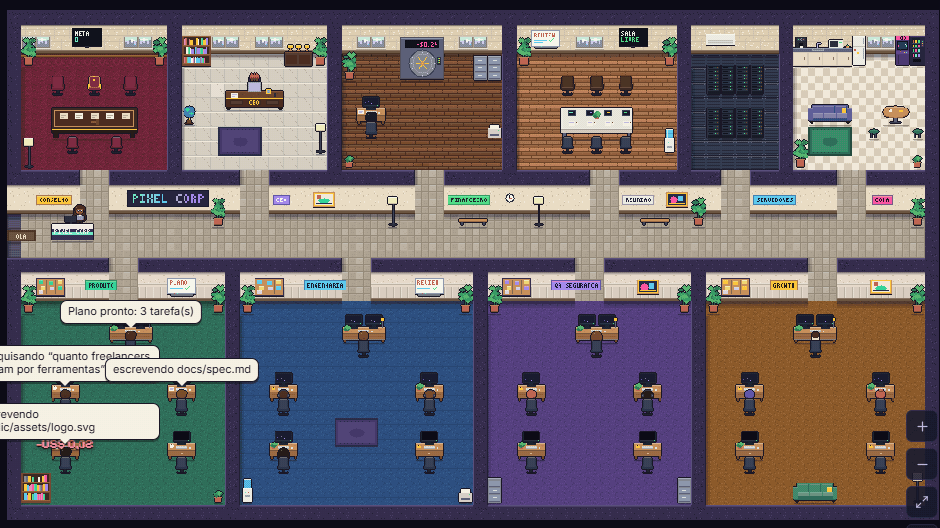

</div>

O escritório **não é a fonte da verdade**: é uma projeção de um log de eventos imutável.
Tudo que acontece vira evento, e o Phaser só anima o que chega — o que dá replay de graça.
O que torna esta empresa melhor que o "agente que ficou rico sozinho":

- 🧪 **Verificação por evidência** — CI de verdade (sintaxe, lint, testes, varredura de
  segredos), autoconferência e revisão do líder com rubrica; a CEO só vê integração.
- 💰 **Dinheiro contado por código** — livro-caixa em micro-dólares, preço por modelo,
  cache, contexto longo, flex/batch; a meta é **lucro líquido**, lida da fonte de receita.
- 🧯 **Orçamento rígido** — o pior caso de cada chamada é checado contra o teto da missão
  e o orçamento da tarefa **antes** de gastar.
- 🏛️ **Você é o Conselho** — publicar, fazer deploy, gastar e falar com gente de verdade
  passam por aprovação humana. Um botão de pânico pausa tudo na hora.

---

## ⚡ Em 1 minuto

Requisitos: Node 22+, pnpm 10, Git. Docker é opcional.

```bash
pnpm install
pnpm dev
```

Abra **http://localhost:5173**. Enquanto a API liga (na primeira vez o banco é criado e os
workflows do Temporal são compilados), o prédio vai acendendo as janelas e a página entra
sozinha quando ela responde.

<div align="center">
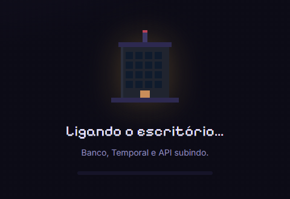
</div>

### 🔑 A única configuração: a sua chave da OpenAI

Na primeira vez o escritório pede **uma coisa só**. Cole a chave e clique em
*Conectar e ligar o modo real*: a API confere a chave (listar modelos é gratuito e mostra
se a conta enxerga os modelos dos cargos), guarda em `.env.local` (fora do git e da imagem
Docker) e religa a empresa em modo real em poucos segundos, sem reiniciar nada.

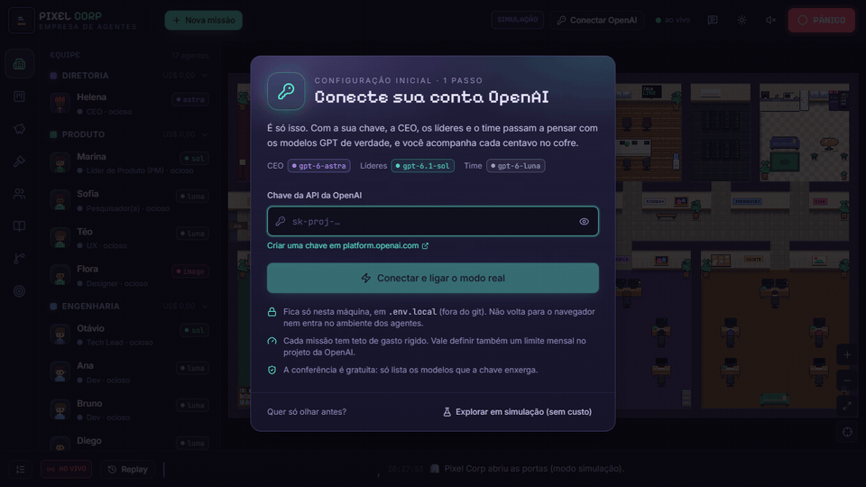

Quer só olhar antes? *Explorar em simulação* não pede chave nem cobra nada, e o botão
**Conectar OpenAI** no topo fica à mão para depois. O `pnpm dev` sobe três coisas em
paralelo (Turborepo):

| Processo | Endereço | O que é |
|---|---|---|
| Temporal dev server | `localhost:7233` · UI em http://localhost:8233 | baixado automaticamente na 1ª vez (`.tools/`), histórico persistente em `.data/temporal` |
| API + worker | http://localhost:4000 | Fastify (REST + WebSocket) com o worker Temporal embutido |
| Escritório | http://localhost:5173 | React + Vite + Phaser |

> Na **simulação** os "cérebros" são roteirizados, mas as mãos são reais — Temporal, banco
> (PGlite com pgvector), Git com worktrees, CI rodando testes de verdade, livro-caixa com a
> tabela de preços real. Para ver tudo mais rápido: `SIM_SPEED=3 pnpm dev`.

---

## 🎬 Tour pelas funcionalidades

> Todas as animações abaixo foram gravadas do próprio app, numa missão de verdade em modo
> simulação — nada é maquete.

### 1. 🎯 Crie uma missão

*"Só pare quando gerar US$ 10 mil"* vira uma missão com quatro campos: **meta de lucro
líquido**, **teto de gasto**, **prazo** e **fonte da receita**. A CEO é acionada na hora,
pensa (o balão mostra o resumo do raciocínio) e delega aos líderes de cada time.

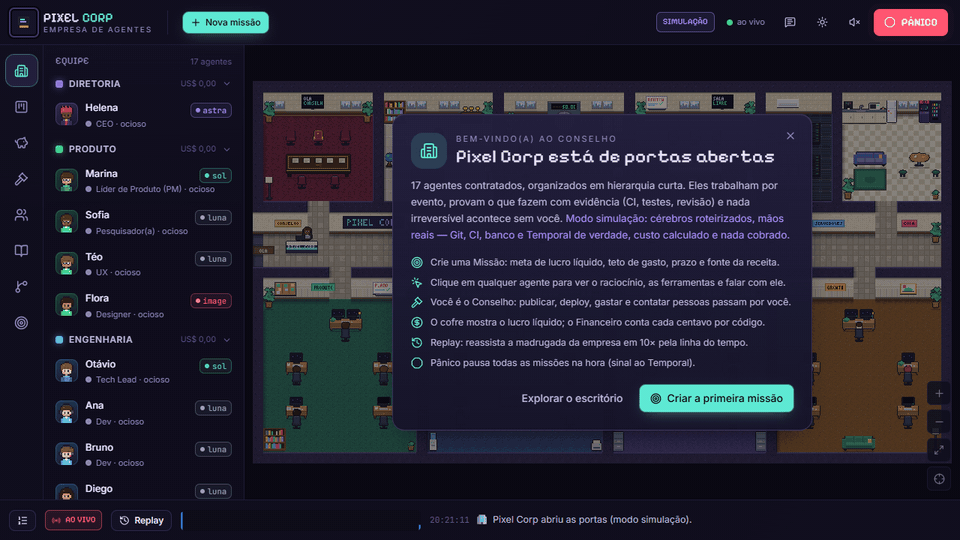

### 2. 🔍 Inspecione qualquer agente — e fale com ele

Clique em alguém (no mapa ou no elenco): a câmera aproxima e o inspetor mostra o
**resumo do raciocínio em streaming**, a linha do tempo de **ferramentas** (escrever
arquivo, rodar `node --test`, checar sintaxe), arquivos alterados, tokens e custo. O campo
*Falar com…* manda um recado que entra no próximo turno do trabalho; a confirmação sai na hora.

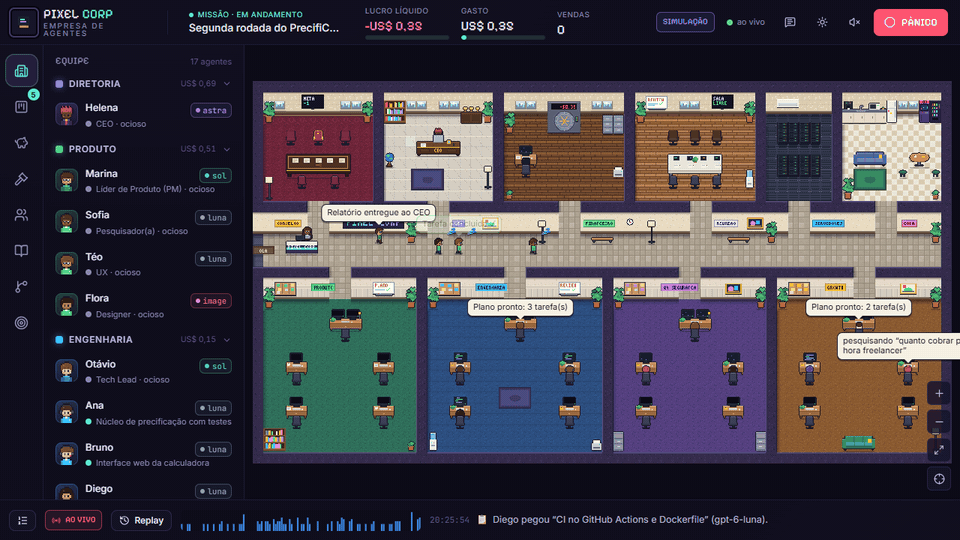

### 3. 📋 Quadro de tarefas, CI e revisão

Tarefas descem pelas colunas (*na fila → em andamento → CI → revisão → concluídas*). Cada
cartão abre a **ordem de serviço**, os **4 portões do CI** com a saída de cada um, o
**parecer de revisão** e o **diff do PR** integrado na `main`. A escada de modelos aparece
no cartão: CI vermelho 2× no Luna → a tarefa é promovida ao Sol.

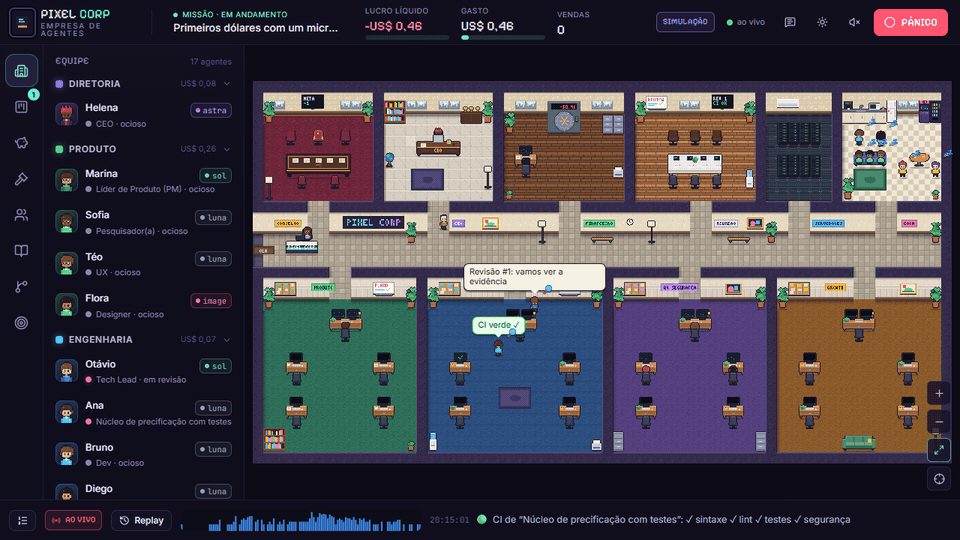

### 4. 🏛️ O Conselho aprova o irreversível

Publicar, fazer deploy, gastar dinheiro e contatar pessoas viram **pedidos ao Conselho**:
o martelo pulsa no topo, o pedido chega à sala do Conselho no mapa e você aprova (ou rejeita)
com uma nota — aqui, a URL de produção. Aprovado, o produto vai ao ar.

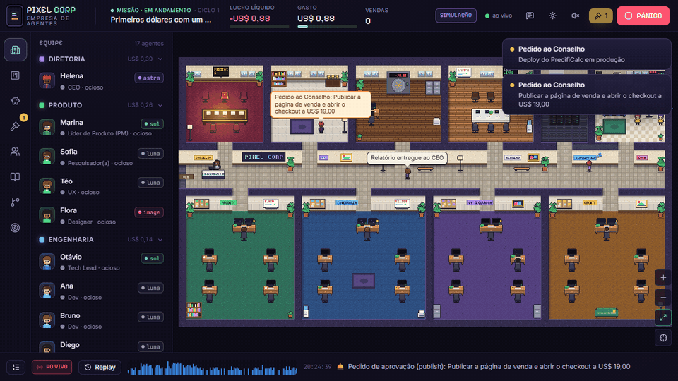

### 5. 💸 Vendas, cofre e meta batida

Depois do lançamento, cada venda cai como moeda no **cofre** e o lucro líquido sobe no topo.
Quem declara a meta é o **Financeiro, por código** — nunca a CEO. Meta batida: confete,
fanfarra e a empresa inteira comemorando.

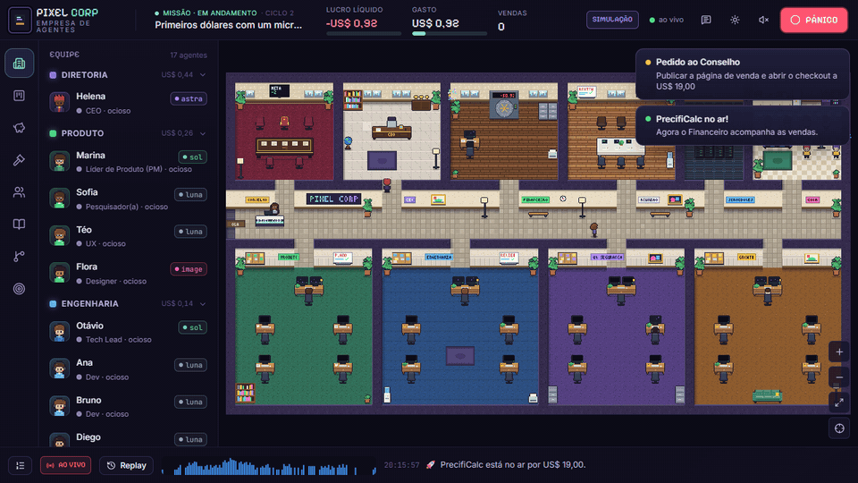

### 6. 📈 Financeiro

Lucro líquido, receita, gasto contra o teto, custo por venda e por modelo/time/tipo, e o
livro-caixa linha a linha. Gráficos com uma série cada, tooltip com cruz de mira e tabela
equivalente para quem prefere números.


### 7. 👥 Equipe e `roles.yaml` ao vivo

O organograma do plano e o editor do `roles.yaml`: troque modelo, esforço, cobrança e
orçamento por cargo, ou promova um agente. **Vale na próxima chamada, sem deploy** — e o
arquivo é editado no lugar, com o diff no git mostrando só a linha que mudou.

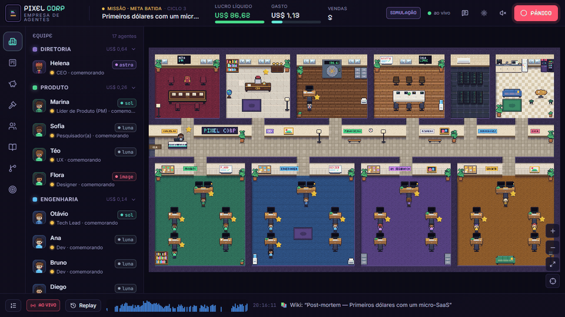

### 8. 📚 Wiki com busca semântica

Pesquisas, especificações, relatórios financeiros e **post-mortems** escritos pela empresa,
com busca vetorial (pgvector). Toda missão termina com a linha do tempo, o que funcionou e o
que melhorar.

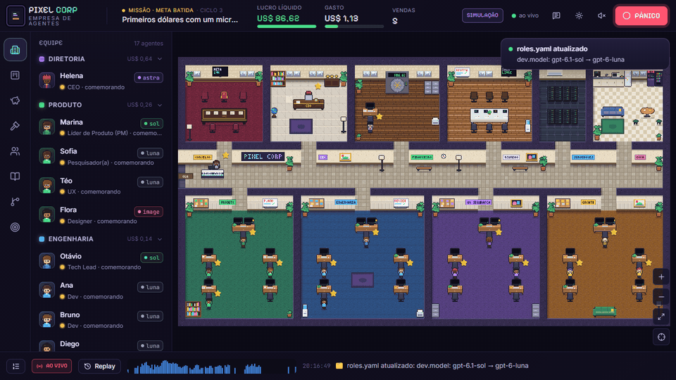

### 9. 🌿 Um repositório Git por missão

Cada tarefa trabalha num **worktree** e branch próprios; o PR é a entrega, o CI é a
evidência e o merge entra na `main` serializado por trava. Navegue pelos arquivos que os
agentes escreveram.

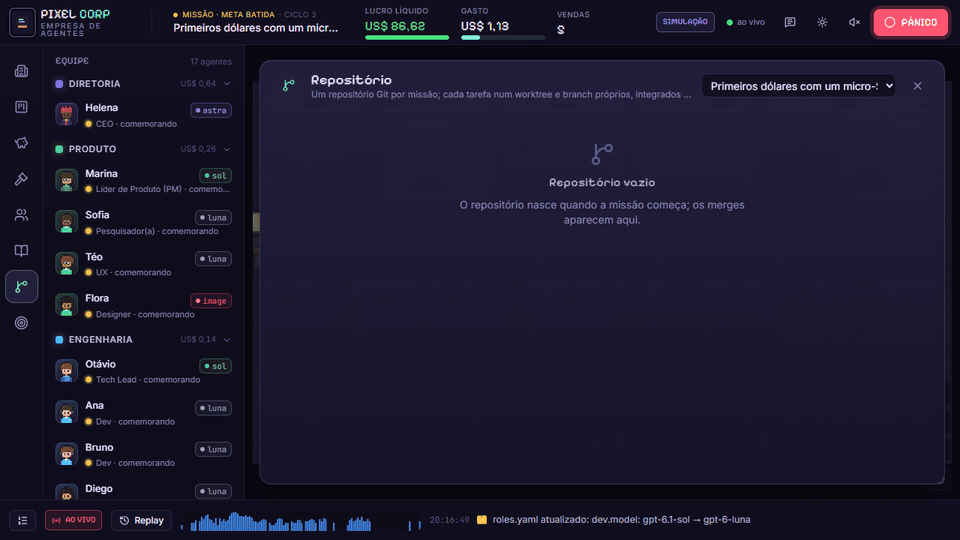

### 10. 🚨 Pânico, ⏪ replay e 🌙 dia e noite

<table>
<tr>
<td width="50%" valign="top">

**Pânico** — grava a pausa, emite o evento e sinaliza todos os workflows no Temporal. O
escritório fica vermelho e todo mundo congela até você retomar.

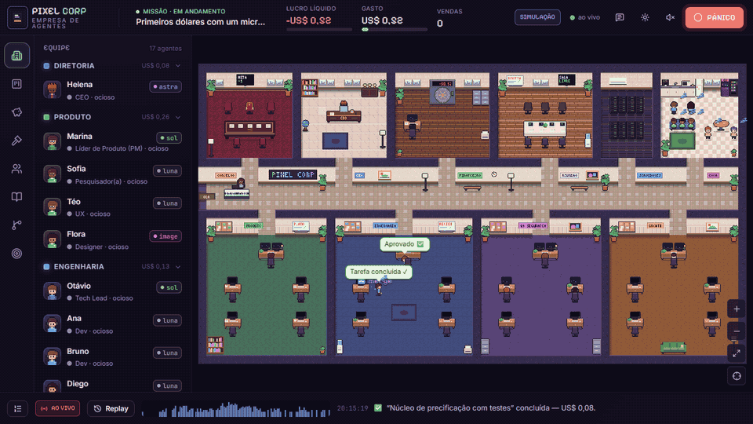

</td>
<td width="50%" valign="top">

**Dia e noite** — a iluminação segue o relógio (ou o cursor do replay): luminárias acendem,
telas brilham. Também dá para fixar dia ou noite.

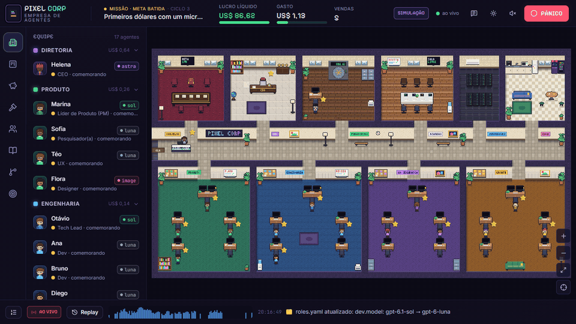

</td>
</tr>
</table>

**Replay** — reassista a missão inteira em 1×–60×, pulando o silêncio. *Você dorme,
acorda e assiste à madrugada da empresa em 10×.*

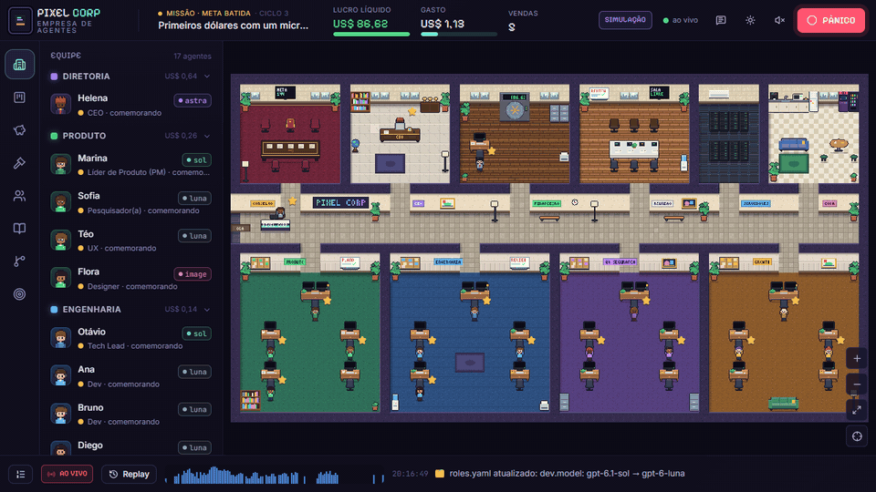

O mapa tem uma sala por time, a sala da CEO, a sala de reunião (onde as revisões
acontecem), a sala do Conselho, a copa (para ociosos e bloqueados), a sala de servidores
(pisca quando o CI roda) e o cofre, cujo painel mostra o lucro líquido. Clique no cofre, na
mesa do Conselho, nos servidores ou na estante para abrir o painel correspondente.

---

## 🧠 Como a empresa trabalha


- **Temporal é a espinha.** Missões de semanas sobrevivem a crash e deploy; retries,
  timers e sinais (aprovação, pânico) são do Temporal. Reinicie a API no meio de uma
  missão: ela continua de onde parou.
- **Documentos com schema fixo.** Os agentes não conversam em texto livre: trocam
  ordem de serviço, relatório de entrega e parecer de revisão, validados com o mesmo
  schema Zod que tipa a interface (Structured Outputs no modo estrito).
- **A fonte da verdade são os artefatos** — o repositório Git da missão, o quadro e a
  wiki. Mensagens só apontam para eles.
- **Escada de modelos** — a tarefa começa no Luna; CI falha 2× → promove ao Sol; falha
  de novo → volta ao líder, que reescreve a especificação; depois CEO; depois Conselho.
- **Isolamento** — o QA recebe a spec e o código da main, nunca a conversa do dev; quem
  lê a internet não tem ferramenta de escrita nem chave de nada (validado no schema do
  `roles.yaml`).
- **CEO por evento, nunca por timer** — início, relatórios, marcos de receita (25/50/75%),
  estagnação e decisões do Conselho. Ela lê relatórios condensados, nunca código, e o
  contexto é cortado para ficar abaixo de 272 mil tokens.
- **A missão termina no que vier primeiro** — meta batida (declarada pelo Financeiro,
  nunca pela CEO), orçamento esgotado ou prazo vencido. Um vigia financeiro roda em
  paralelo e cancela o trabalho em andamento quando o fim chega.

<details>
<summary><b>Diagrama dos workflows (Temporal)</b></summary>

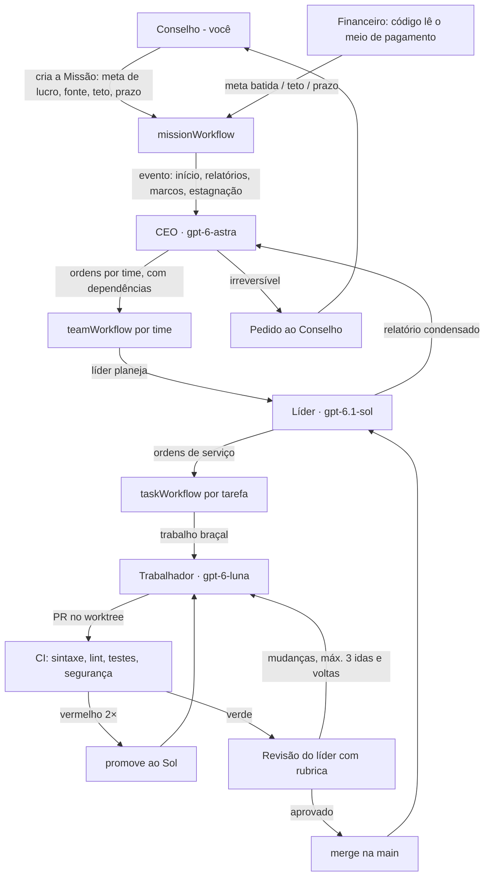

</details>

Detalhes do schema de eventos e do `roles.yaml`: [docs/eventos-e-cargos.md](docs/eventos-e-cargos.md).

---

## 🧭 Do plano ao código

| No plano | Onde está |
|---|---|
| Organograma e modelo por cargo | [`config/roles.yaml`](config/roles.yaml) · aba **Equipe** |
| Preços, cache, contexto longo, flex/batch | [`config/pricing.yaml`](config/pricing.yaml) · [`packages/contracts/src/pricing.ts`](packages/contracts/src/pricing.ts) (testado com os números do plano) |
| Ordem de serviço, relatório de entrega, parecer | [`packages/contracts/src/documents.ts`](packages/contracts/src/documents.ts) |
| Schema de eventos | [`packages/contracts/src/events.ts`](packages/contracts/src/events.ts) |
| Escritório como projeção do log | [`packages/contracts/src/projection/`](packages/contracts/src/projection/) (mesmo código no front e no servidor) |
| Missão, times, tarefas, revisões, escada | [`packages/engine/src/temporal/workflows/index.ts`](packages/engine/src/temporal/workflows/index.ts) |
| Dinheiro por código, guarda de orçamento, pânico | [`packages/engine/src/llm/gateway.ts`](packages/engine/src/llm/gateway.ts) · [`db/ledger.ts`](packages/engine/src/db/ledger.ts) |
| Responses API (CEO, líderes, pesquisa, copy) | [`packages/engine/src/llm/openai.ts`](packages/engine/src/llm/openai.ts) |
| Configuração inicial (só a chave) | [`packages/engine/src/setup.ts`](packages/engine/src/setup.ts) · [`apps/server/src/setup-routes.ts`](apps/server/src/setup-routes.ts) · [`apps/web/src/ui/Setup.tsx`](apps/web/src/ui/Setup.tsx) |
| `WorkerRuntime` (trabalho braçal trocável) | [`packages/engine/src/runtime/`](packages/engine/src/runtime/): `toolloop` (Responses + sandbox), `agents-api` (Agents API, sandbox hospedada), `designer` (imagens), `sim` |
| O PR é a entrega, o CI é a evidência | [`packages/engine/src/repo/`](packages/engine/src/repo/): worktree por tarefa, `ci.json`, GitHub opcional |
| Wiki com busca semântica (pgvector) | [`db/repos.ts`](packages/engine/src/db/repos.ts) · aba **Wiki** |
| Receita do merchant-of-record | [`finance/revenue.ts`](packages/engine/src/finance/revenue.ts): Polar, Lemon Squeezy, Paddle, simulado |
| PostHog, Tavily, Firecrawl | [`finance/analytics.ts`](packages/engine/src/finance/analytics.ts) · [`runtime/tools.ts`](packages/engine/src/runtime/tools.ts) |
| Langfuse com OpenTelemetry | [`packages/engine/src/telemetry.ts`](packages/engine/src/telemetry.ts) |
| Escritório: Phaser, Tiled, easystar.js | [`apps/web/src/office/`](apps/web/src/office/) · mapa em [`apps/web/public/assets/office/office.tmj`](apps/web/public/assets/office/office.tmj) |
| Painéis: React, Vite, Zustand | [`apps/web/src/ui/`](apps/web/src/ui/) |
| Evals por cargo | [`packages/engine/src/evals/run.ts`](packages/engine/src/evals/run.ts) · [`evals/tasks/`](evals/tasks/) |
| Docker Compose numa VPS | [`docker-compose.yml`](docker-compose.yml) · [`Dockerfile`](Dockerfile) |

---

## 🔀 Modo simulação × modo real

| | Simulação | Real |
|---|---|---|
| Ativar | *Explorar em simulação* (ou `LLM_PROVIDER=sim`) | colar a chave na tela inicial (ou `LLM_PROVIDER=openai` + `OPENAI_API_KEY`) |
| Decisões e trabalho | roteirizados (produto de exemplo: PrecifiCalc) | Responses API com os modelos do `roles.yaml` |
| Git, CI, Temporal, banco, livro-caixa | **reais** | reais |
| Custo | calculado com a tabela real, nada cobrado | cobrado na sua conta, limitado pelo teto da missão |
| Execução de código | local (só `node`), código roteirizado | **Docker sem rede** se o Docker estiver no ar; senão local (só `node`, ambiente sem chaves) com aviso na interface. `SANDBOX` força um dos dois |
| Receita | mercado simulado lido "como" um MoR | Polar, Lemon Squeezy ou Paddle (chave só de leitura), ou o mercado simulado: agentes reais, clientes fictícios |

Quem decide o modo, em ordem:

1. `LLM_PROVIDER=sim` no ambiente → simulação (testes, e2e e CI usam isto);
2. `LLM_PROVIDER=openai` → real, com a chave da tela inicial ou a `OPENAI_API_KEY`;
3. chave salva pela tela inicial (`.env.local`) → real;
4. nada → simulação, com a tela inicial pedindo a chave.

Uma `OPENAI_API_KEY` solta no ambiente global **não** liga o modo real sozinha: gastar é
escolha explícita. O selo **SIMULAÇÃO / MODO REAL** no topo abre a mesma tela para trocar
a chave ou voltar para a simulação (só sem missão em andamento, para não misturar
cérebros na mesma missão). A chave inteira nunca volta para o navegador (só
`sk-proj-…a1B2`) nem entra no ambiente dos comandos dos agentes.

No modo real, configure também o spend limit do projeto na OpenAI (rede de segurança
extra além do livro-caixa) e comece pelo que o plano recomenda: os primeiros
US$ 100 de lucro com teto de gasto bem abaixo disso.

`WORKER_RUNTIME=agents` usa a Agents API (beta) com sandbox hospedada: o worktree vai
como arquivos inline, o agente devolve relatório + arquivos alterados, e **o nosso**
CI verifica. Recados do Conselho viram `agent.session.input.message` (steering do
turno ativo). A chave nunca entra na sandbox.

---

## 🔧 Configuração

- **`config/roles.yaml`** — cargos: modelo, esforço (`none`…`max`), cobrança
  (`standard`/`flex`/`batch`), orçamento por tarefa, instâncias, ferramentas, escada de
  modelos; regras da empresa (rodadas de revisão, falhas até promover…); promoções por
  agente em `overrides`. A interface edita este arquivo no lugar, preservando comentários.
- **`config/pricing.yaml`** — preços por milhão de tokens (conferidos em 5/out/2026),
  multiplicadores de contexto longo e de flex/batch, busca, imagens e sandbox. Modelo
  sem preço é erro: nada é gasto sem contabilidade.
- **`config/prompts/`** — o manual da empresa (prefixo estável, aproveita o cache) e o
  prompt de cada cargo.
- **`.env`** — veja [`.env.example`](.env.example): provedor, sandbox, Postgres/Redis,
  Temporal, token de acesso, fontes de receita, PostHog, Tavily, Firecrawl, GitHub,
  Langfuse.
- **`.env.local`** — escrito pela tela inicial com a chave da OpenAI. Apague o arquivo
  (ou use *Voltar para simulação*) para desconectar.

---

## 🏦 Dinheiro, Conselho e pânico

- **Livro-caixa** em micro-dólares inteiros; cada linha vira um evento na mesma
  transação. Custo = entrada sem cache + cache lido + cache gravado + saída (raciocínio
  é cobrado como saída), × contexto longo acima de 272k, × flex/batch, + buscas.
- **Guarda de orçamento**: antes de cada chamada, o pior caso (entrada estimada + saída
  máxima) é comparado ao que resta do teto da missão e do orçamento da tarefa.
- **Pânico**: o botão grava a pausa no banco, emite o evento e sinaliza todos os
  workflows (que repassam aos filhos). Chamadas em andamento ficam seguras antes de
  gastar; o escritório fica vermelho e todos congelam.
- **Falar com o agente**: o recado entra no próximo turno do trabalho em andamento; a
  confirmação de uma linha sai na hora (Luna sem raciocínio).

---

## 🧱 Editar o escritório no Tiled

O mapa é um `.tmj` do [Tiled](https://www.mapeditor.org/) com camadas de piso,
sombras, paredes, móveis (objetos com imagem), **spots** (mesas, cadeiras da reunião,
copa, cofre…) e salas. Abra `apps/web/public/assets/office/office.tmj` no Tiled, mova
móveis e spots e recarregue o navegador — a grade de caminhada é recalculada a partir
do arquivo. A arte toda é gerada por código ([`packages/pixel-art`](packages/pixel-art)):
`pnpm art` regenera tileset, móveis e mapa (sobrescreve o `.tmj`), e
`pnpm --filter @office/pixel-art readme-art` regenera o banner e o diagrama animados deste
README com os mesmos personagens e a mesma fonte.

---

## 🐳 Modo completo (Docker Compose)

```bash
cp .env.example .env   # ajuste OFFICE_TOKEN, LLM_PROVIDER=openai e OPENAI_API_KEY
docker compose up -d --build
```

Sobe Postgres com pgvector, Redis (pub/sub dos eventos), Temporal + UI, a API (que
também serve o front já buildado em http://localhost:4000) e o worker separado. Com
Postgres, vários workers podem rodar na mesma fila; o Git da main é serializado por
advisory lock. Com o worker separado, a chave vai pelo ambiente (a tela inicial avisa).

---

## ✅ Testes e verificação

```bash
pnpm typecheck   # todos os pacotes
pnpm test        # contratos (preços do plano, escada, ondas, projeção, schemas) e motor (CI do template, orçamento, pânico, modo/chave)
pnpm e2e         # com o pnpm dev rodando em simulação: cria uma missão, aprova o Conselho e exige meta batida dentro do teto
pnpm eval -- --models gpt-6-luna,gpt-6.1-sol   # aprovação × custo por modelo (simulado sem chave; com chave conectada pede --yes)
```

O E2E percorre a empresa inteira pelo Temporal: a CEO delega, os times planejam, o CI pega
dois bugs do Luna, a tarefa é promovida ao Sol, a revisão pede validação de entrada, o QA
testa de forma independente, o Conselho aprova o lançamento, as vendas entram e o
Financeiro declara a meta — com o repositório da missão terminando com uns 20 arquivos
integrados por merge.

---

## 📁 Estrutura

```
apps/
  server/     API Fastify (REST + WebSocket com backlog), worker embutido no modo local
  worker/     worker Temporal standalone (modo completo)
  web/        escritório Phaser + painéis React/Zustand/Tailwind
packages/
  contracts/  schemas Zod (eventos, cargos, documentos, preços), JSON Schema estrito, projeção pura
  engine/     workflows e atividades Temporal, gateway de modelos, livro-caixa, Git/CI, runtimes, finanças
  pixel-art/  arte gerada por código: personagens, tiles, móveis, mapa Tiled, arte do README
tools/temporal-dev/   baixa e sobe o Temporal dev server
config/       roles.yaml, pricing.yaml, prompts/
evals/tasks/  tarefas de calibração com testes ocultos
docs/         eventos e cargos, mídia do README
```

---

## 🚧 Limites conhecidos e próximos passos

- O modo real (Responses API, streaming do raciocínio, Structured Outputs) segue os
  tipos do SDK oficial; a conexão da chave foi testada contra um servidor falso da
  OpenAI, mas nenhuma missão paga rodou no ambiente de desenvolvimento. Comece com teto baixo.
- Os adaptadores de **Agents API**, **Polar/Lemon Squeezy/Paddle**, **PostHog** e
  **GitHub** seguem a documentação pública, mas não foram exercitados contra contas
  reais — confira com as suas credenciais antes de confiar neles.
- O `docker-compose.yml` não foi testado de ponta a ponta (o daemon do Docker estava
  desligado); o modo local (PGlite + Temporal dev server) foi testado de ponta a ponta.
- `billing: batch` é tratado como `flex` nas chamadas síncronas (mesmo desconto); a
  Batch API assíncrona (resultado em até 24 h) é um próximo passo natural para pesquisa
  e conteúdo noturnos.
- Fase 4 do plano (voz com a CEO, várias empresas no mesmo mapa) ainda não começou.
- Sem autenticação além do `OFFICE_TOKEN` opcional: não exponha a API sem ele.
